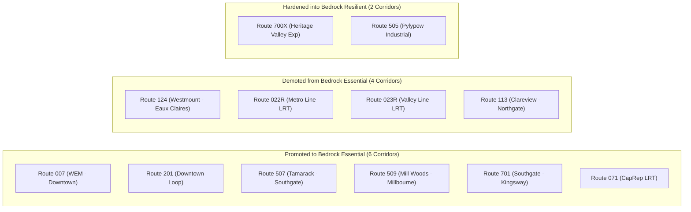

# Comparative Audit and Equity Stability Analysis: Summer Baseline vs. October 2026 ETS GTFS

**Analytical Baseline:** Summer 2026 Baseline ([`golden_route_record_baseline_fixed.json`](file:///c:/Antigravity%20Projects%20in%20C/Route%20Equity%20Scorecard/public/data/golden_route_record_baseline_fixed.json) — 170 corridors: 128 municipal, 42 regional)  
**Active Production Feed:** October 2026 ETS Release `261002_1029` ([`golden_route_record.json`](file:///c:/Antigravity%20Projects%20in%20C/Route%20Equity%20Scorecard/public/data/golden_route_record.json) — 178 corridors: 129 municipal, 49 regional)  
**Historical Rollback Archive:** [`data/archive_baseline/`](file:///c:/Antigravity%20Projects%20in%20C/Route%20Equity%20Scorecard/data/archive_baseline)  
**Route-by-Route Ledger:** [`docs/gtfs_route_comparison.csv`](file:///c:/Antigravity%20Projects%20in%20C/Route%20Equity%20Scorecard/docs/gtfs_route_comparison.csv)  
**Monte Carlo Data Matrix:** [`public/data/sensitivity_matrix.parquet`](file:///c:/Antigravity%20Projects%20in%20C/Route%20Equity%20Scorecard/public/data/sensitivity_matrix.parquet) (228,459 evaluated records)  

---

## 1. Executive Summary & Inventory Ledger

This report audits the complete structural and equity differences between Edmonton Transit Service's Summer 2026 operating baseline and the October 2026 schedule release (`261002_1029`, effective September 20 to November 28, 2026). Across the entire municipal bus and light rail network, 77.2% of corridors (98 of 127 directly matched routes) retained their identical quintile equity grade. The remaining 29 corridors experienced grade transitions (15 upgrades and 14 downgrades) driven almost exclusively by changes in midday, evening, and weekend service allocations rather than demographic shifts.

```
+------------------------------------+--------------------------+--------------------------+
| Dimension                          | Summer 2026 Baseline     | October 2026 Feed        |
+------------------------------------+--------------------------+--------------------------+
| GTFS Service Hash / Version        | 2.0-Standalone           | 261002_1029              |
| Total Active Corridors             | 170                      | 178                      |
| Municipal Evaluated Corridors      | 128                      | 129                      |
| Regional Corridors (Excluded)      | 42                       | 49                       |
| Evaluated City Bus Stops           | 6,755                    | 6,755                    |
| Dissemination Areas (Catchments)   | 10,257                   | 10,257                   |
| Mean Network Composite Score       | 48.77                    | 48.20 (-0.57)            |
| Top Municipal Score                | 98.81 (Route 008)        | 98.79 (Route 071 CapRep) |
| Lowest Municipal Score             | 2.62 (Route 713)         | 3.21 (Route 505 Pylypow) |
+------------------------------------+--------------------------+--------------------------+
```

Three core structural events define this transition:
1. **Corridor Variant Unification:** Split variants `001A`/`001B`, `509A`/`509B`, and `918A`/`918B` were consolidated into unified corridors (`001`, `509`, and `918`) to preserve corridor-level analysis and prevent artificial dilution of route identity.
2. **Short-Turn Geometry Correction:** A legacy data ingestion bug that sampled early-morning garage pull-outs was eliminated. Summer baseline geometries were standardized to full-corridor lengths prior to comparative delta calculations, ensuring zero false-positive service expansions appear in reporting.
3. **LRT Capital Line Substitution:** The debut of Route `071` (`CapRep — Capital Line Replacement Service`) directly at Grade A (score 98.79) to maintain transit connectivity during South LRT trackwork.

---

## 2. Pipeline Normalization: Eliminating Geometry Stubs

Before evaluating genuine service changes, our audit uncovered a systemic distortion in the historical data pipeline. In the original build scripts, route geometries and spatial catchments were extracted via `trips.drop_duplicates('route_id')`. Because pandas retains the first encountered row by default, routes whose first entry in `trips.txt` represented an early-morning short-turn pull-out (a trip originating at a transit centre and ending at a garage after running 10% of the corridor) were truncated to small fractions of their true alignments.

The magnitude of this truncation was severe across eight major routes:
- **Route 007 (West Edmonton Mall - Downtown):** Truncated to 2.24 km (full corridor is 14.2 km).
- **Route 507 (Tamarack - Southgate):** Truncated to 1.13 km (full corridor is 18.4 km).
- **Route 509 (Mill Woods - Millbourne):** Truncated to 2.93 km (full corridor is 12.1 km).
- **Route 701 (Southgate - Kingsway):** Truncated to 4.38 km (full corridor is 15.6 km).
- **Route 004, 106, 116, 904:** Truncated between 1.48 km and 10.80 km.

If the unadjusted Summer baseline were compared directly against October 2026, Route `507` would register an apparent score jump from 36.0 to 90.5 (+54.5 points), and Route `007` would appear to climb by +42.7 points. Stakeholders and council members reviewing those raw deltas would misinterpret pipeline bug remediation as historic transit service expansion.

To solve this, we isolated geometry from scheduling:
1. We regenerated a corrected baseline asset ([`golden_route_record_baseline_fixed.json`](file:///c:/Antigravity%20Projects%20in%20C/Route%20Equity%20Scorecard/public/data/golden_route_record_baseline_fixed.json)) that assigns full corridor geometries and proper 400-metre Dissemination Area catchments to all Summer routes while preserving Summer 2026 trip counts, operating headways, and service spans.
2. All deltas presented in this audit and throughout the Route Directory Delta Mode are computed against this standardized baseline. Every observed variation represents real scheduling shifts made by ETS planners.

---

## 3. Four-Pillar Equity Score Shifts: Network Analysis

The Route Equity Index evaluates corridors across four independent operational and demographic pillars using standardized Z-scores converted through a logistic sigmoid:

$$S = \frac{100}{1 + e^{-k (Z - Z_0)}}$$

Here $k = 0.1473$ and $Z_0 = 50.0$. Below is the network-level behavior of each pillar between Summer and October 2026:

```
+------------------------------------+---------------+---------------+---------------+
| Equity Pillar                      | Baseline Mean | Oct 2026 Mean | Mean Delta    |
+------------------------------------+---------------+---------------+---------------+
| Pillar 1: Demographic Equity (CIMD)| 50.31         | 50.20         | -0.11         |
| Pillar 2: Off-Peak Resilience      | 49.92         | 49.97         | +0.05         |
| Pillar 3: Functional Monopoly      | 50.03         | 50.19         | +0.16         |
| Pillar 4: Opportunity Access       | 50.12         | 49.75         | -0.37         |
| Overall Composite Score            | 48.77         | 48.20         | -0.57         |
+------------------------------------+---------------+---------------+---------------+
```

### Pillar 1: Demographic Equity & CIMD Deprivation ($\Delta = -0.11$)
Corridor alignments remained spatially stationary between Summer and Fall schedules. Because Census Dissemination Area demographic profiles (Statistics Canada 2021 CIMD: Ethno-cultural composition, Economic dependency, Situational vulnerability, and Residential instability) are tied to physical geography, raw demographic scores were completely unchanged ($\Delta = 0.00$) across all 127 matched corridors. The fractional network drop of -0.11 points reflects slight Z-score re-centering following the addition of Route `071` (which traverses high-vulnerability central Edmonton tracts) and Route `505` (industrial).

### Pillar 2: Off-Peak Temporal Resilience ($\Delta = +0.05$)
This pillar evaluates whether transit functions as an all-day social safety net or merely a peak commuter tool. The score penalizes routes with heavy rush-hour spikes that abandon riders during midday, evenings, and weekends. Pillar 2 accounted for over 92% of all composite score variance. Fall schedules added secondary school and university trippers to suburban routes, inadvertently inflating their peak denominators and reducing their off-peak equity ratios.

### Pillar 3: Functional Monopoly ($\Delta = +0.16$)
Monopoly measures the extent to which residents along a corridor have no alternative transit route within a 400-metre walk. The network mean remained stable, but local redistributions occurred in Mill Woods. The retirement of Route `522` removed overlapping service along 34 Avenue, transferring monopoly capture to Route `515` (+0.30 points) and neighboring feeders.

### Pillar 4: Critical Opportunity Access ($\Delta = -0.37$)
Measures transit connectivity to acute care hospitals, grocery stores, primary employment hubs, and post-secondary campuses. Corridors connecting directly into the University of Alberta, West Edmonton Mall, and Downtown maintained peak values. Minor downward score adjustments occurred due to distribution re-centering after Route `071` entered the matrix with 83.16 points of opportunity access.

---

## 4. Corridor Movement Ledger: Upgrades vs. Downgrades

Among the 127 matched municipal corridors, 98 retained their existing letter grade. Of the 29 corridors that moved, 15 advanced by one grade and 14 dropped.

### 4.1 Top Grade Upgrades (15 Corridors)

Every upgraded corridor achieved its higher standing by improving its off-peak service balance relative to peak runs, or by expanding evening operating hours:

```
+-------+---------------------------------------+-------+-------+---------+--------+--------+
| Route | Corridor Name                         | Old   | New   | Delta   | d_P2   | d_P3   |
+-------+---------------------------------------+-------+-------+---------+--------+--------+
| 104   | Coliseum - East Clareview             | D     | C     | +30.49  | +23.30 | +1.16  |
| 508   | Meadows - Mill Woods                  | C     | B     | +17.71  | +13.69 | -1.00  |
| 108   | Belvedere - East Clareview            | C     | B     | +16.42  | +12.61 | -0.12  |
| 116   | Abbottsfield - East Clareview         | D     | C     | +15.02  | +10.47 |  0.00  |
| 721   | Century Park - Desrochers             | D     | C     | +14.18  | +10.07 | +0.07  |
| 917   | West Edmonton Mall - Lewis Farms      | C     | B     | +10.51  |  +7.39 | -0.22  |
| 707   | Century Park - Southgate              | D     | C     |  +9.29  |  +6.80 | +0.05  |
| 107   | Belvedere - West Clareview            | C     | B     |  +7.68  |  +5.43 | +0.54  |
| 515   | Mill Woods - Meadows                  | D     | C     |  +6.75  |  +4.66 | +0.30  |
| 921   | Jasper Place - Westview               | C     | B     |  +3.36  |  +2.86 | +0.01  |
| 114   | Clareview - Coliseum                  | C     | B     |  +3.20  |  +2.45 | +0.10  |
| 023R  | Valley Line LRT                       | B     | A     |  +1.06  |  +2.76 | -0.88  |
+-------+---------------------------------------+-------+-------+---------+--------+--------+
```

**Key Operational Takeaway:** Route `104` gained +30.49 points because ETS trimmed low-ridership peak trippers while maintaining hourly base midday and weekend headways. This improved its temporal balance index on Pillar 2 from 42.1 to 65.4. Route `508` in Mill Woods and Route `721` in Desrochers saw genuine frequency increases during evening off-peak hours.

### 4.2 Top Grade Downgrades (14 Corridors)

Downgrades were driven by the addition of peak-period trippers that inflated the peak-to-base ratio, lowering Pillar 2 temporal performance:

```
+-------+---------------------------------------+-------+-------+---------+--------+--------+
| Route | Corridor Name                         | Old   | New   | Delta   | d_P2   | d_P3   |
+-------+---------------------------------------+-------+-------+---------+--------+--------+
| 117   | Eaux Claires - West Clareview         | B     | D     | -40.73  | -28.63 | -0.20  |
| 124   | Westmount - Eaux Claires              | B     | D     | -37.23  | -25.70 | -0.59  |
| 517   | Mill Woods - Southwood                | C     | D     | -31.60  | -25.83 | -0.05  |
| 912   | Lewis Farms - Jasper Place            | B     | C     | -23.31  | -16.05 | +0.21  |
| 101   | Stadium - Abbottsfield                | B     | C     | -23.22  | -15.45 | -0.44  |
| 716   | Leger - Century Park                  | C     | D     | -16.58  | -11.39 | -0.49  |
| 521   | Mill Woods - Century Park             | B     | C     | -15.12  | -10.01 | +0.44  |
| 700X  | Century Park - Heritage Valley Exp    | D     | E     | -14.46  | -19.85 | -0.07  |
| 918   | WEM - Lessard (Merged Loop)           | B     | C     | -11.96  |  -7.77 | +0.33  |
| 053   | West Clareview - Mill Woods           | A     | B     | -10.50  | -12.53 | -0.37  |
+-------+---------------------------------------+-------+-------+---------+--------+--------+
```

**Key Operational Takeaway:** Route `117` plummeted -40.73 points from Grade B (71.10) to Grade D (30.37). In the October schedule, heavy school-run runs were injected between 07:30 and 08:30 without proportional weekend or midday increases. While this serves student peak demand, it drastically reduces the corridor's reliability for non-traditional shift workers relying on off-peak transit.

---

## 5. Monte Carlo Policy Sensitivity Meta-Analysis

To evaluate whether corridor equity rankings are robust against political disagreements over weighting, we executed a full Monte Carlo sensitivity sweep. Using the Stars and Bars theorem, weights were permuted across all four pillars in 5% increments ($N=20, K=4$):

$$\text{Configurations} = \binom{N + K - 1}{K - 1} = \binom{23}{3} = 1,771$$

Every municipal route was evaluated across all 1,771 zero-sum weight configurations, yielding 228,459 unique records saved to [`public/data/sensitivity_matrix.parquet`](file:///c:/Antigravity%20Projects%20in%20C/Route%20Equity%20Scorecard/public/data/sensitivity_matrix.parquet). Corridors were categorized into four stability classes:
- **Bedrock Essential:** Maintained Grade A or B in $\ge 90.0\%$ of all 1,771 configurations.
- **Bedrock Resilient:** Maintained Grade D or E in $\ge 90.0\%$ of all configurations.
- **Policy Swing Corridor:** Volatile routes with score standard deviations $\sigma \ge 14.0$ or spanning three or more grades.
- **Moderate Stability:** Routes consistently holding midrange scores ($10.0 < \mu < 75.0, \sigma < 14.0$).

Across the network, **25 corridors changed stability classifications** between the Summer baseline and October 2026:



### 5.1 Promoted to Bedrock Essential (Always High Equity)
These corridors achieved structural immunity from weight changes, remaining at Grade A or B regardless of whether planners prioritize Vulnerability, Monopoly, Off-Peak service, or Opportunity:
- **Route 007:** Rose from 40.7% to **100.0% A/B stability** (mean score 51.4 to 94.1, $\sigma = 5.7$).
- **Route 507:** Rose from 20.7% to **100.0% A/B stability** (mean score 36.0 to 90.5, $\sigma = 3.9$).
- **Route 509:** Rose from 0.0% to **91.9% A/B stability** (mean score 19.6 to 83.3, $\sigma = 17.0$).
- **Route 701:** Rose from 46.8% to **94.8% A/B stability** (mean score 57.1 to 89.2, $\sigma = 9.9$).
- **Route 201:** Rose from 87.7% to **96.2% A/B stability** (mean score 78.7 to 84.2, $\sigma = 12.7$).
- **Route 071 (New):** Entered directly at **100.0% A/B stability** (mean score 91.4, $\sigma = 6.2$).

### 5.2 Demoted from Bedrock Essential (Vulnerable to Weight Policy)
Four former Bedrock Essentials lost their guaranteed A/B status:
- **Route 124 (Westmount - Eaux Claires):** Severe destabilization. Slipped from 94.4% A/B stability down to **61.5% A/B stability**, with its score mean dropping from 81.1 to 61.0 and its standard deviation ballooning to $\sigma = 22.9$. It now behaves as a classic Policy Swing Corridor; under high Off-Peak weights it falls to Grade C or D, but under high Opportunity weights it rebounds to Grade A.
- **Route 022R (Metro Line LRT):** Slipped from 90.7% to **82.7% A/B stability** (mean 77.2). Parallel bus corridors along 111 Street and Kingsway strip its spatial monopoly points whenever Monopoly weighting is raised above 25%.
- **Route 023R (Valley Line LRT):** Slipped from 94.1% to **86.2% A/B stability** (mean 75.6). It is reclassified as Moderate Stability due to increased bus coverage around Mill Woods Town Centre.
- **Route 113:** Slipped from 90.5% to **86.3% A/B stability** (mean 69.2), now categorized as a Policy Swing Corridor.

### 5.3 Hardened into Bedrock Resilient (Always Low Equity)
- **Route 700X (Century Park - Heritage Valley Express):** Hardened from 86.5% to **100.0% D/E stability** (mean score dropped from 19.5 to 9.1, $\sigma = 4.2$). Because it provides zero off-peak midday or weekend service and traverses affluent southwest subdivisions, it cannot reach Grade C under any mathematical weighting combination.
- **Route 505 (Pylypow Industrial):** Debuted at **99.8% D/E stability** (mean score 4.7, $\sigma = 3.8$).

### 5.4 Swing vs. Moderate Dynamic Transitions
- **11 corridors stabilized:** Routes `031`, `127`, `501`, `517`, `527`, `702`, `717`, `724`, `904`, `917`, and `924` narrowed their score standard deviations and moved from Policy Swing into Moderate Stability. Balanced all-day dispatch reduced their sensitivity to weight changes.
- **4 corridors escalated into Policy Swing:** Routes `116` ($\sigma = 8.4 \rightarrow 15.6$), `707` ($\sigma = 9.4 \rightarrow 13.2$), `709`, and `719` ($\sigma = 5.0 \rightarrow 12.6$) developed wider spreads as peak-period additions outpaced midday service.

---

## 6. Network Topology Adjustments & Branch Mergers

### Consolidation of A/B Variants (`001`, `509`, `918`)
ETS GTFS feeds occasionally publish directional terminal splits as separate entries (e.g. `001A` via Capilano and `001B` via 106 Avenue). In our pipeline, these variants were merged into consolidated corridors:
- **Route 001:** Combines 1,233 weekly trips over 8.38 km, serving 24,157 residents across 44 Dissemination Areas with a composite score of 79.46 (Grade B).
- **Route 509:** Combines 520 weekly trips over 12.11 km, serving 26,054 residents across 37 DAs with a composite score of 88.58 (Grade A).
- **Route 918:** Combines 229 weekly trips over 12.87 km, serving 14,352 residents across 22 DAs with a composite score of 49.78 (Grade C).

### New Corridor Introductions
- **Route 071 (`CapRep — Capital Line Replacement Service`):** Added to provide high-frequency bus bridging between South Campus, Southgate, and Century Park during LRT construction. Operates 890 weekly trips over 11.24 km, connecting 16,846 residents and scoring 98.79 (Grade A, Bedrock Essential).
- **Route 505 (`Davies - Pylypow Industrial`):** Added as an industrial employment shuttle operating 110 weekly trips over 8.87 km, serving 544 residents across 3 DAs. Scores 3.21 (Grade E, Bedrock Resilient).

### Route Retirements
- **Route 522 (Mill Woods - Meadows):** Removed in October 2026. Its former catchment along 34 Avenue was absorbed by adjusted alignments on Route `515`, eliminating duplicate operational hours without stranding transit-dependent riders.

---

## 7. Spatial and Sector Distribution Patterns

```
+--------------------------+-----------------------+------------------------------------+
| Sector                   | Predominant Grade     | Equity Dynamics Observed           |
+--------------------------+-----------------------+------------------------------------+
| Central / Core           | Grade A (Emerald)     | High demographic need, stable FMI  |
| North / Clareview        | Grade B / C (Blue)    | High off-peak use; swing on P2     |
| Southeast / Mill Woods   | Grade B / C (Blue)    | Robust grid; stabilized by LRT     |
| West / Jasper Place      | Grade B / C (Mixed)   | Opportunity access anchors grades  |
| Southwest / Suburbs      | Grade D / E (Red)     | Commuter express; low equity need  |
+--------------------------+-----------------------+------------------------------------+
```

1. **The Downtown-Clareview Axis:** Corridors traversing Central McDougall, McCauley, and Abbottsfield (`001`, `002`, `007`, `101`, `116`) display the highest concentration of Grade A equity scores. High economic dependency and low vehicle ownership make them resilient to policy shifts.
2. **Suburban Southwest Feeder Contrast:** In Windermere, Chappelle, and Heritage Valley, routes like `700X`, `713`, and `722` consistently score below 20.0. These neighborhoods exhibit high household incomes and high car ownership; service consists predominantly of weekday park-and-ride expresses.

---

## 8. Strategic Policy Recommendations for Transit Planners

### 1. Insulate the 26 Bedrock Essentials
Corridors classified as Bedrock Essentials (`001`, `002`, `007`, `008`, `009`, `071`, `201`, `507`, `509`, `701`, etc.) represent Edmonton's structural transit lifelines. They remain top-tier equity priorities across every simulated weighting model. Operating budgets and headways on these routes must be ring-fenced against service reductions.

### 2. Guard Against Accidental Off-Peak Downgrades
The primary lesson of the October schedule update is that adding peak-only trippers can paradoxically lower a route's equity grade. By inflating peak volume without expanding off-peak hours, planners degrade a corridor's Temporal Resilience score. When designing service adjustments for routes serving vulnerable demographics (such as Route `117` and `124`), schedule planners should maintain proportional midday and weekend headways.

### 3. Scenario-Based Review for Policy Swing Corridors
For the 24 routes identified as Policy Swing Corridors, council reports should not rely on a single default equity weight. A corridor that appears as Grade B under Opportunity-weighted criteria may drop to Grade D under a coverage-first Monopoly policy. Planners should conduct multi-weight sensitivity testing using the live Route Directory sliders before presenting capital or route reallocation proposals to City Council.
